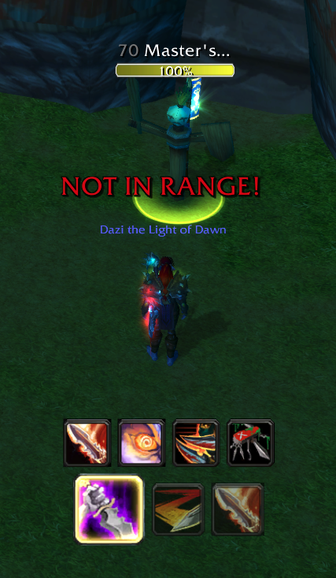

# RogueRotation

Next-action rotation helper for Combat Rogues in **World of Warcraft 3.3.5a (WotLK)**. Shows the action to press right now — drawn larger — plus the next two actions beside it. Zero dependencies.



## Features

- **Live next-action queue** — current action shown large, the next two upcoming actions smaller, all on one center line.
- **GCD-aware suggestions** — Killing Spree and Adrenaline Rush are suggested while the global cooldown is still running, instead of only after it expires.
- **Trinket-gated Killing Spree** — KS only goes when a trinket effect is up and no usable trinket is left unused. If both trinkets are off cooldown and neither is up yet, it waits for the burst.
- **Adrenaline Rush rides with Killing Spree** — AR is held back while KS is ready or within ~6 seconds of coming off cooldown, so it is never wasted just before a KS.
- **Keeps Slice and Dice up**, uses Blade Flurry on cooldown, Eviscerate at 4–5 combo points, Sinister Strike to build.
- **Buff trackers** for Slice and Dice / Blade Flurry / Adrenaline Rush with swipe and countdown.
- **Cooldown row** for Blade Flurry / Adrenaline Rush / Killing Spree / Tricks of the Trade — TOT bounces while usable in combat.
- **Lightweight** — event-driven aura cache, per-tick cooldown cache, adaptive refresh (10 Hz with a target, 2 Hz idle), no per-tick allocations.
- Movable frame — drag it anywhere.

## Installation

1. Download `RogueRotation-1.0.0.zip` from the [latest release](../../releases/latest).
2. Extract the `RogueRotation` folder into `World of Warcraft/Interface/AddOns/`.
3. Restart the game or `/reload`.

Or clone it straight into your AddOns folder:

```sh
cd "World of Warcraft/Interface/AddOns"
git clone https://github.com/tje3d/RogueRotation.git
```

## Usage

Select a target and the queue updates by itself; the left-most icon is what to press next. Drag the frame to reposition it. It appears only for Rogues.

## Compatibility

- Interface 30300 (WotLK 3.3.5a), English client spell names.

## Notes

`Core.lua`, `Rotation.lua` and `UI.lua` are an unused early prototype and are not loaded by the `.toc`.
